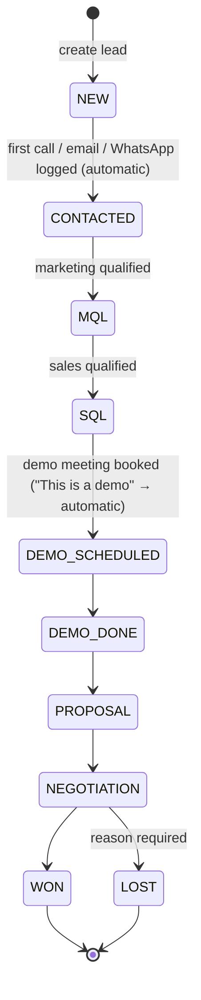

# PAL – Leads (sales pipeline)

## Journey

- Any stage can move to any other stage (the board supports drag and drop; the lead page has a clickable stepper). **LOST needs a reason.** WON / LOST close every open follow-up.
- **Source** includes Search engine (Google / Bing, SEO, search ads), Website, Referral, Social media, Email campaign, Cold call, Event, Partner, Advertisement, Other.
- **Requirement** is rich text (TipTap editor), sanitised on the server.
- **Temperature** (🔥 Hot / ☀️ Warm / ❄️ Cold) is independent of the stage.
- Every change — stage, temperature, owner, details, call / email / WhatsApp / note, follow-up planned / done / cancelled, meeting scheduled / cancelled — is written to the **lead journey** (`lead_activities`).

## Who can do what

| | MANAGER and above | Owner / creator | Follow-up assignee, meeting invitee |
|---|---|---|---|
| See the lead | all leads | ✅ | ✅ |
| Log updates, plan follow-ups, change stage / temperature, schedule meetings | ✅ | ✅ | ✅ |
| Edit details, reassign owner | ✅ | ✅ | ❌ |
| Delete | ✅ | ❌ | ❌ |

Anyone can create a lead. Any active user can be the owner or a follow-up assignee (they are notified).

## Follow-ups

`LeadFollowUp`: type (call, email, WhatsApp, meeting, other), due time, assignee, note. Mark it **done** with an outcome and plan the next one in the same step, **reschedule** it (+1 day snooze), or **cancel** it. The lead's `nextFollowUpAt` always shows the earliest pending one, so the list can filter on "overdue", "today" and "none planned".

## Meetings with leads

Schedule from the lead page (**Meeting** or **Schedule demo**). The meeting is linked to the lead (`meetings.leadId`), and you can invite:
- **team members**: PAL users, notified in-app (and by email if they have that turned on);
- **external guests**: any email address. No PAL account is created. The lead's own email is pre-filled.

How external guests are invited:
- **Organiser connected Google Calendar**: the event is created in their calendar. It gets a Google Meet link if no link was given. Google emails every attendee an invite with accept / decline buttons. Edits and cancellations are synced, and Google emails the updates.
- **Otherwise**: guests get an email from `NOTIFY_MAIL_USER` with an `.ics` invite that Outlook, Apple Calendar and Gmail accept. Updates and cancellations are emailed too (same UID, so the calendar entry is replaced).

Setup: `GOOGLE_CLIENT_ID` / `GOOGLE_CLIENT_SECRET` in `.env` (see `.env.example`). Each user then clicks **Connect Google Calendar** on the Meetings page. Tokens are stored encrypted in `google_accounts`.

## Reminders (5 minutes before)

A background job runs every minute (`src/instrumentation.ts` → `src/lib/reminders.ts`):
- **Meetings**: the organiser and every attendee who hasn't declined get a `MEETING_REMINDER`. External guests are emailed too when the meeting is not on Google Calendar (Google sends its own reminder). Changing the time re-arms the reminder.
- **Follow-ups**: the assignee gets `LEAD_FOLLOW_UP_DUE` with the lead's phone or email. Rescheduling re-arms it.

Each reminder is claimed with a conditional update before sending, so it is sent once. Reminders show as in-app toasts and desktop notifications (when enabled), plus email when the user has email notifications on.

## API

| Method | Path | |
|---|---|---|
| GET / POST | `/api/leads` | list + pipeline summary (`?q ?stage ?temperature ?source ?ownerId=me ?followUp=overdue\|today\|none ?status=open\|won\|lost\|all`) / create (optional `firstFollowUp`) |
| GET / PATCH / DELETE | `/api/leads/{id}` | detail with journey, follow-ups, meetings / edit, reassign / delete |
| POST | `/api/leads/{id}/stage` | `{ stage, note?, lostReason? }` |
| POST | `/api/leads/{id}/temperature` | `{ temperature }` |
| POST | `/api/leads/{id}/activities` | `{ type: NOTE\|CALL\|EMAIL\|WHATSAPP, note, nextFollowUp? }` |
| POST | `/api/leads/{id}/follow-ups` | `{ type, dueAt, assigneeId?, note? }` |
| GET | `/api/leads/follow-ups` | my queue (`?when=overdue\|today\|upcoming\|done ?scope=team`) |
| PATCH | `/api/leads/follow-ups/{id}` | `{ action: done, outcome?, nextFollowUp? }` · `{ action: cancel }` · `{ action: reschedule, dueAt }` |
| POST | `/api/meetings` | now also takes `guests: [{ email, name? }]`, `leadId`, `isDemo`, `syncGoogle` |
| GET / DELETE | `/api/integrations/google` | connection status / disconnect |
| POST | `/api/integrations/google/connect` | returns the Google consent URL |
