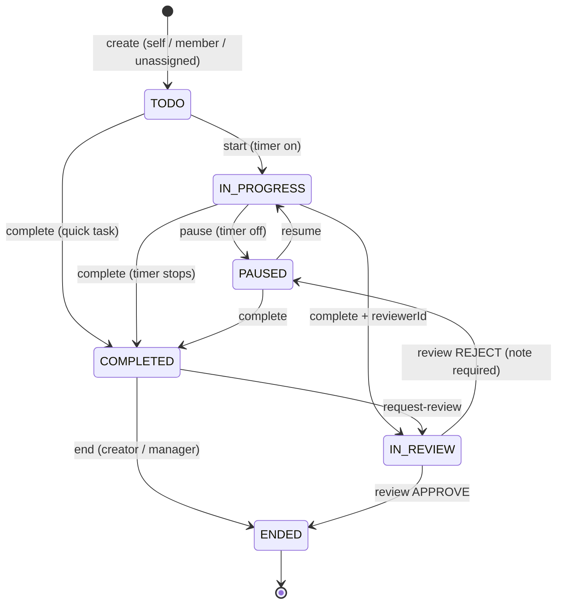

# PAL – Project & Task Workflow

## Who can do what

| Action | SUPER_ADMIN / COMPANY_HEAD | MANAGER | LEAD / STAFF |
|---|---|---|---|
| Create project (name only required) | ✅ | ✅ | ❌ |
| See project | all projects | own / member | member only |
| Edit project, add/remove members | ✅ all | ✅ own / member | ❌ |
| Create task / sub-task | ✅ | ✅ | ✅ (members) |
| Assign task to others | ✅ | ✅ | LEAD → lower roles only; STAFF → self only |
| Start / pause / complete a task | **only the assignee** | | |
| End a COMPLETED task | creator or project manager | | |
| Review (approve / reject) | assigned reviewer or project manager | | |

> A task created by someone else can only be started, paused and completed by the person it is assigned to.

## Task lifecycle

Rules
- A user can run **one** task timer at a time (starting another returns 409 with the running task).
- Worked time is accumulated per task (`workedSeconds`) and returned live in `workedMinutes`.
- A task with sub-tasks can only be completed when every direct sub-task is COMPLETED or ENDED.
- Sub-tasks nest (a sub-task can have its own sub-tasks); deleting a task deletes its sub-tasks.
- Only TODO tasks can be reassigned. ENDED tasks are read-only.
- Every transition is stored in the task activity log (`GET /api/tasks/{id}`).
- Project progress = ENDED tasks / all tasks.

## Typical flow

1. Manager `POST /api/projects` → `POST /api/projects/{id}/members` for staff.
2. Anyone in the project `POST /api/projects/{id}/tasks` (title only is required; add description, estimate, due date, priority; set `parentId` for sub-tasks).
3. Assignee `start` → `pause` / `start` …
4. Assignee `complete` (optionally with `reviewerId`) → reviewer `review` → **ENDED**, or creator `end` for tasks without review.
