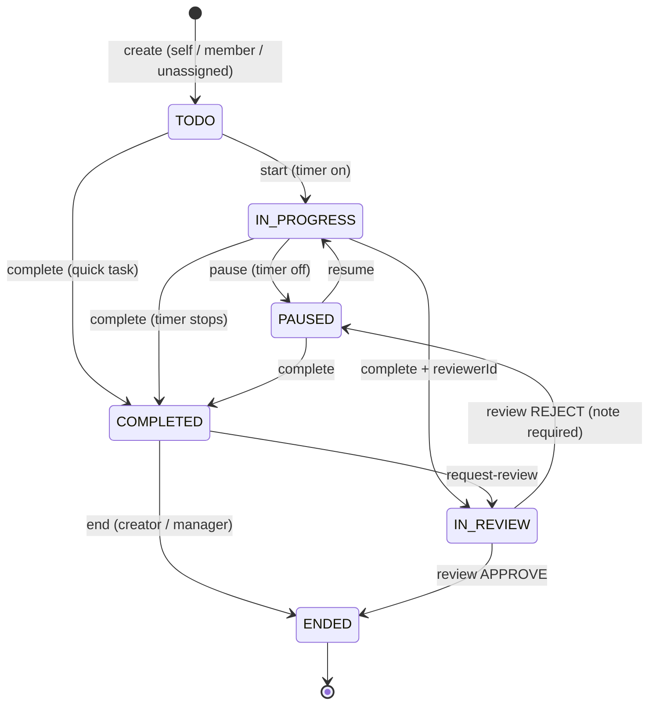

# PAL – Project & Task Workflow

## Who can do what

| Action | SUPER_ADMIN / COMPANY_HEAD | MANAGER | LEAD / STAFF |
|---|---|---|---|
| Create project (name only required) | ✅ | ✅ | ❌ |
| See project | all projects | own / member | member only |
| Edit project, add/remove members | ✅ all | ✅ own / member | ❌ |
| Create task / sub-task | ✅ | ✅ | ✅ (members) |
| Assign task to others | ✅ | ✅ | LEAD → lower roles only; STAFF → self only |
| Start / pause / complete a task | **only the assignee** | | |
| End a COMPLETED task | creator or project manager | | |
| Review (approve / reject) | assigned reviewer or project manager | | |
| Delete a task (with all its sub-tasks) | project manager | | creator, while still TODO |

> A task created by someone else can only be started, paused and completed by the person it is assigned to.

## Task lifecycle

Rules
- **The day timer is the master timer.** A task timer can only start while the day timer is running. Pausing (break) or ending the day pauses every running task timer automatically.
- **End of shift:** when the clock reaches the schedule's end time the day timer is paused automatically (stamped at exactly the end time, `WorkEvent.auto = true`) and all task timers pause with it. The person may resume afterwards to keep working; the system does not pause again after a deliberate resume. Enforced by a 1-minute sweep (`src/instrumentation.ts`) plus a lazy check on attendance/task reads.
- **Team oversight:** LEAD and above can open `/team` to see everyone ranked below them — live status, tasks, and a 7/30/90-day work-culture score (attendance, punctuality, daily target met, on-time tasks). `GET /api/team`, `GET /api/team/{id}`.
- Any active user, of any role, can be added to a project by a project manager (`GET /api/directory` feeds the picker).
- A user can run **one** task timer at a time (starting another returns 409 with the running task).
- Worked time is accumulated per task (`workedSeconds`) and returned live in `workedMinutes`.
- A task with sub-tasks can only be completed when every direct sub-task is COMPLETED or ENDED.
- Sub-tasks nest (a sub-task can have its own sub-tasks); deleting a task deletes its sub-tasks.
- Only TODO tasks can be reassigned. ENDED tasks are read-only.
- Every transition is stored in the task activity log (`GET /api/tasks/{id}`).
- Project progress = ENDED tasks / all tasks.

## Typical flow

1. Manager `POST /api/projects` → `POST /api/projects/{id}/members` for staff.
2. Anyone in the project `POST /api/projects/{id}/tasks` (title only is required; add description, estimate, due date, priority; set `parentId` for sub-tasks).
3. Assignee `start` → `pause` / `start` …
4. Assignee `complete` (optionally with `reviewerId`) → reviewer `review` → **ENDED**, or creator `end` for tasks without review.

## Deleting

| What | Who | Notes |
|---|---|---|
| Task | project managers; the creator while it is still TODO | Deletes every nested sub-task, comments and logged time. Refused while anyone's timer is running on it or a sub-task. |
| Request | requester while PENDING / RESUBMITTED / REJECTED / CANCELLED; SUPER_ADMIN / COMPANY_HEAD any | Approved / completed requests stay as a record. |
| Meeting | organiser; SUPER_ADMIN / COMPANY_HEAD | If it is still upcoming, invitees are notified, external guests emailed a cancellation, the Google Calendar event removed and the lead journey updated first. |

Notifications that pointed at the deleted item are removed as well.

## PAL-NO (reference numbers)

Every task and every request gets a company-wide number from one shared sequence, shown as **PAL-0001**, PAL-0002, … in creation order (`pal_numbers` issues them with AUTO_INCREMENT, so two people creating at the same moment never get the same number; a failed create may leave a gap). Existing tasks and requests were numbered oldest-first by the `20260112000000_pal_no` migration.

- Search boxes (My tasks, project board, Requests, Team) accept `PAL-0012`, `pal 12`, `#12` or `12`.
- The top bar's **Go to PAL-…** box opens the task or request directly (`GET /api/lookup?q=PAL-0012`, respects permissions).
- Click the number in a task / request panel to copy it.

## My tasks → Assigned by me

`GET /api/tasks/me?role=assigner`: tasks you created or assigned to someone, that have at least one other person on them. Shows each person's progress (not started / working now / paused / finished / declined) and filters by person, progress, status, priority, project, due date, task vs sub-task, plus search and sort.
